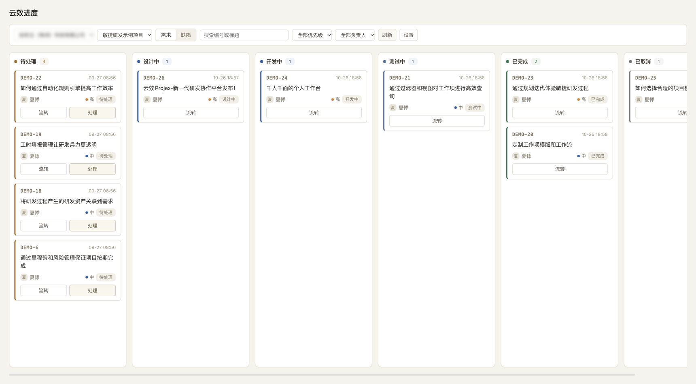
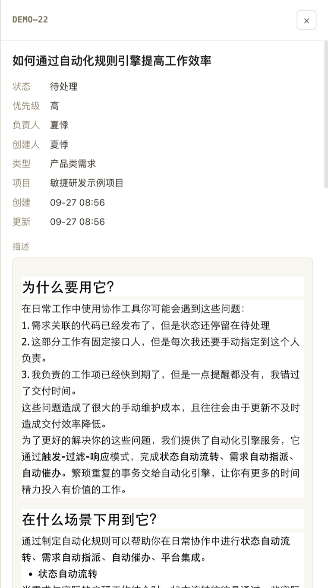

# dsh-yunxiao-taskboard

DeepSeek Harness（DSH）插件：把阿里云云效的**需求和缺陷**按状态看板展示，点开即看详情，可一键派到工作区处理。

数据实时读云效 OpenAPI，本地不另存工作项。

## ✨ 功能

- 📋 **按状态看板** - 需求 / 缺陷分栏，按状态列展示，支持关键词与编号检索
- 🔍 **详情抽屉** - 状态、负责人、创建人、类型、项目、时间、描述（富文本排版保留）、附件
- 🖼️ **图片预览** - 描述内图片经 Host 换取 OSS 直链，点开弹层等比预览，不跳转不下载
- 🚀 **一键派发** - 「处理」按钮选择工作区，直接起会话并预填 prompt
- 🛠️ **原生工具** - `yunxiao_workitems`（查项目 / 工作项 / 状态）、`yunxiao_transition`（流转状态）
- 🔐 **令牌只在 Host** - 令牌不出 Host 进程，前端不回显、不进日志

## 📸 截图

**看板**：需求 / 缺陷分栏按状态展示，卡片可拖拽流转，支持编号检索与优先级、负责人筛选。



**详情**：状态、负责人、类型、时间等字段，描述按原富文本排版展示（图片、附件同源）。



## 📦 安装

以 npm 组合包分发：[`dsh-yunxiao-taskboard`](https://www.npmjs.com/package/dsh-yunxiao-taskboard)，按组合包安装，无需本地目录。要求 DSH `>= 0.2.1-rc.3`（声明在 `engines.dsh`）。

**Web**：侧边栏「插件」→「添加插件」→ 搜索框填 `dsh-yunxiao-taskboard` → 安装。

**交给 Agent**：`plugin_manager` → `install_bundle`，`target` 填 `dsh-yunxiao-taskboard`。

**CLI**：

```bash
dsh plugin --profile <profile> add dsh-yunxiao-taskboard
```

CLI 只装依赖，还要在「插件」页启用 `dsh-yunxiao-taskboard` 组合包（等价于在 profile 的 `dsh.profile.bundles` 里追加）。

安装后刷新 DSH Web，在插件设置里填令牌（配置见下）。

## ⚙️ 配置

插件 Config（设置页可改），非空值优先，空值退回环境变量：

| 字段 | 必填 | 空值退回 | 说明 |
| --- | --- | --- | --- |
| `token` | 是 | `YUNXIAO_API_KEY` | 云效个人访问令牌，`writeOnly` |
| `organizationId` | 中心版必填 | `YUNXIAO_ORG_ID` | Region 版留空 |
| `baseUrl` | 否 | `YUNXIAO_API_BASE_URL` → `https://openapi-rdc.aliyuncs.com` | Region 版填组织域名 |
| `edition` | 否 | 由 `organizationId` 是否为空推断 | `center` / `region` |

请求头固定 `x-yunxiao-token`。

## 🧪 开发

```bash
node --test        # 23 个用例，覆盖连接解析、检索条件、组织列表、流转校验
```

发布（`files` 白名单已限定包内容，`prepublishOnly` 先跑测试）：

```bash
npm pack --dry-run   # 核对 tarball 内容
npm publish          # publishConfig.access = public
```

代码结构：

```
index.js          Host 侧插件入口（工具注册、/yunxiao 路由）
client.js         Client 侧看板与详情 UI
server/           云效 API 封装、连接配置、看板逻辑
test/             node:test 单测
docs/superpowers/ 设计规格与实施计划
```

## 📄 License

MIT
